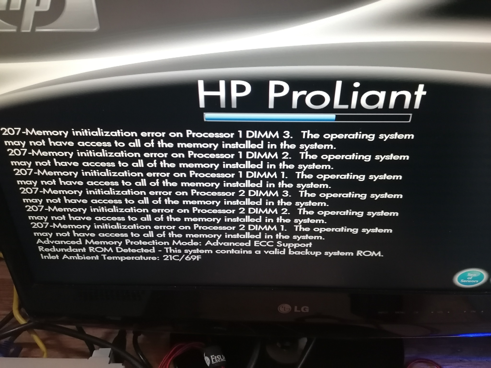
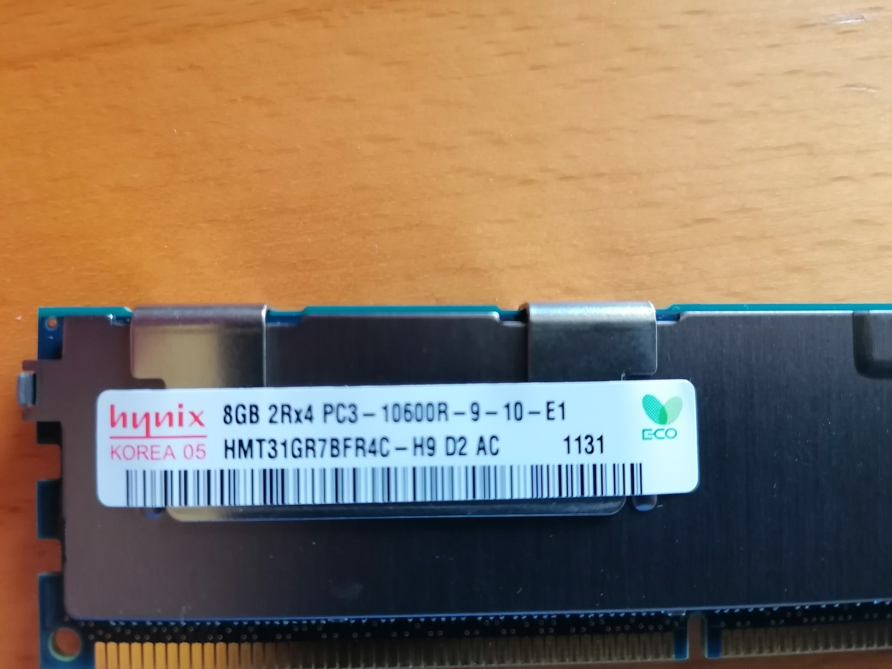
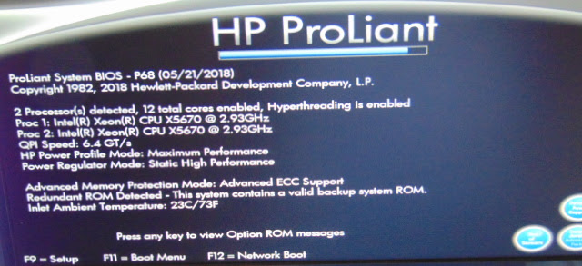

# Hyper-V Home Lab

I built a Windows virtualisation lab on a refurbished HP ProLiant DL360 G7. I used it to practise Active Directory administration, test Windows client setups and troubleshoot server hardware.

| Component | Configuration |
| --- | --- |
| Hyper-V host | Windows Server 2019 Datacenter |
| Processors | Two Intel Xeon X5670 CPUs, 12 physical cores total |
| Memory | 72 GB of working RAM after troubleshooting |
| Storage | Six 300 GB, 10,000 rpm SAS drives |
| Guest operating systems | Windows Server 2022, Windows Server 2025 and Windows 11 |

I set up an Active Directory domain in a Windows Server VM and used Windows 11 VMs to test client setups.

## Case study: diagnosing faulty server RAM

The server reported POST error 207 (memory initialisation error) on DIMM slots associated with both processors. I removed and tested memory modules to isolate the faulty ones. After removing those modules, I returned the server to service with 72 GB of working RAM.

*POST error 207 before troubleshooting.*

*8 GB Hynix PC3-10600R registered server memory module.*

*Startup after troubleshooting. The screen shows both processors and all 12 physical cores.*

